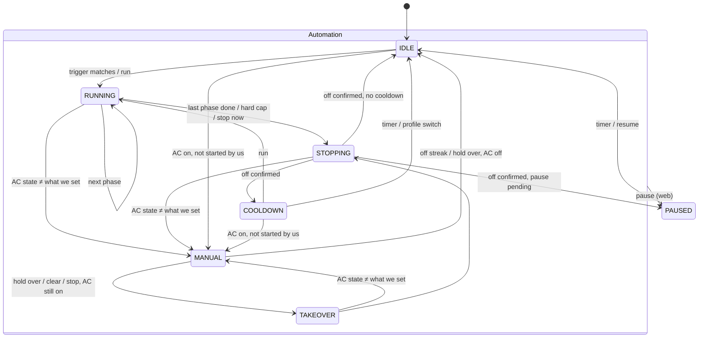

# Smart AC control: design

Goal: a Pico 2 W watches the room and runs the Daikin AC in short,
purposeful cycles instead of leaving it on all day. It should cool when it's hot, dry when
it's humid, always dry out the coil afterwards, and stay out of the way when a human uses the remote.
Profiles and their parameters are edited from a web page served by the Pico.

API details: [DAIKIN_API.md](DAIKIN_API.md). Firmware structure: [architecture.md](architecture.md).
Plan and the decision log: [roadmap.md](roadmap.md).

The firmware is MicroPython ([ADR 0001](decisions/0001-language.md)). The config files and the HTTP API below are
the contract; the same logic runs on the Mac against a simulator ([ADR 0002](decisions/0002-functional-core.md)).

## How it is used

- The AC is **off by default**. When the Pico is running, it owns the AC: it switches it on for a cycle and off again.
- The owner switches the Pico on when at home (above all at night, when nobody can watch the AC) and may switch it
  off when leaving. Switching the Pico off mid-cycle is a normal event: the AC then simply stays under remote control.
- It must also run unattended for days or weeks without drifting into a bad state.
- **No wall clock.** The Pico never needs the date or time of day ([ADR 0004](decisions/0004-time.md)). Profiles are chosen
  by hand (for example `night` at bedtime); every duration is relative: "cool for up to 30 min, then fan 20 min, then
  wait 30 min".

## What we can rely on

| Capability | Status |
|---|---|
| Read room temp (whole °C), humidity (%), outdoor temp (0.5 °C) | confirmed |
| Power on/off, mode (cool/fan/dry/heat/auto), cool target temp | confirmed (written + read back) |
| Fan speed | confirmed (S3, S5: changed while running, felt at the outlet) |
| Dry mode `0500` | confirmed (S2); no target temperature, see below |
| Streamer | readable, **not** writable (rsc 4000); stays as the remote set it across API writes (S4) |
| Mold-proof | unmapped |
| Room readings while the unit is off | update (S1, 2026-10-16, incl. a 6.5 h off period overnight): temp 0.5 °C steps, humidity 5 % steps |

Facts that shape the design:
- **Sensor is the AC's own**, near the ceiling, in 0.5 °C steps. "> 29" really means "≥ 29.5".
  Right after the unit stops, readings can drift, so a cooldown wait is needed before judging again.
- **The remote overwrites everything** when any button is pressed (one-way IR, full state).
- **No auth on the API**: anything on the LAN can control the AC.
- Room humidity has been 80–85 % in testing, so humidity matters at least as much as temperature.

## Core concept: a profile is a list of rules; a rule is a trigger plus a sequence of phases

```
profile
└── rules[]        checked in order, first match wins
      ├── trigger      conditions on temp / humidity / outdoor temp
      ├── phases[]     run in order; each has a mode and ends on time OR a goal, whichever comes first
      │     ├── mode, target temp, fan speed
      │     ├── max_min
      │     └── until    optional goal, e.g. temp <= 26 or humidity <= 65
      ├── end          power off (always)
      └── cooldown     minutes to wait before triggers are checked again
```

While a cycle runs, triggers are not checked. The cycle just runs its phases.
It still reads sensors each minute so `until` goals can end a phase early.

Every rule that cools or dries ends with a **fan phase** to dry the coil.
This is our own mold-proof, and it's easy to stop.

## Profiles (defaults)

### day
| Rule | Trigger | Phases | Cooldown |
|---|---|---|---|
| too hot | temp > 29 | cool, target 26, **30 min or until temp ≤ 26**; then fan 20 min | 30 min |
| humid | humidity > 75 | dry, **60 min or until humidity ≤ 65**; then fan 20 min | 45 min |

First match wins, so a hot and humid room is cooled (cooling also dries).
Dry mode removes moisture with less cooling and less power than cool mode.

### night
| Rule | Trigger | Phases | Cooldown |
|---|---|---|---|
| warm | temp > 27 | cool, target 26, quiet fan, 45 min or until temp ≤ 26; then fan quiet 15 min | 30 min |
| humid | humidity > 75 | dry, quiet fan, 45 min or until humidity ≤ 65; then fan quiet 15 min | 45 min |

### away
Nobody home: only prevent mold and damp, don't cool.
| Rule | Trigger | Phases | Min. interval |
|---|---|---|---|
| damp | humidity > 80 | dry 30 min; then fan 20 min | 4 h between starts |

### off
Automation does nothing, not even the manual-hold takeover below. Kill switch.

## Choosing the active profile

1. **From the web page** (dropdown). The choice is saved and survives a reboot.
2. Later: **physical button** on the Pico (cycles profiles, LED blinks the profile number),
   or **presence** (see Later ideas).

## State machine



`RUNNING` steps through the rule's phases (phase *n* of *m*). `MANUAL` means hands off: automation doesn't touch the
AC. `PAUSED` can be entered from any state; what happens to a running cycle is described below.

Ownership rules are in [ADR 0003](decisions/0003-ac-ownership.md): every write is decided from a read in the same tick
(read before write), checked by a read-back ~5 s later, and automation never touches a state a human set
until the manual hold is over.

**STOPPING** writes off every tick until a read confirms it; only then does the cooldown start. Any read that shows
the AC off ends the stop, whoever switched it off.

**Writes and reads.** Each write attempt is judged once, by its read-back (or by the next poll read if the
read-back was missed). A mismatch counts as a failed attempt, and the write is sent again on the next poll. Two failed
attempts → `write_failed` and `MANUAL` (in `STOPPING`: an event, and the off write keeps being retried). Human changes
are detected on poll reads only: a read-back may catch the AC while it is still applying our write. The
`RUNNING`/`TAKEOVER` timers (phase length, goals, hard cap) act only on a reachable poll read, but time keeps counting
while the AC is unreachable. Actions that arrive on a read-back step, or before the first reachable read after a boot,
are queued until the next poll step.

**Manual override detection.** After each write, remember what we set (power, mode, target, fan).
Each minute, compare it with what the AC reports. If it differs, a human used the remote or the app:
- stop the cycle and don't touch anything,
- stay hands-off for `manual_hold_min` (each new change by the human restarts the hold),
- or until the human turns the AC off and it stays off for `manual_release_off_min`.

If the AC is on and we didn't turn it on (for example, it was on when the Pico booted), also go MANUAL.

**TAKEOVER.** If the hold is over and the AC is still on, the Pico ends the run the way a cycle ends:
fan for `finish_fan_min` if the mode was cool or dry, then off, then `IDLE` (no cooldown). Not in the `off` profile and
not while PAUSED. The hold also ends early on **Clear manual** or **Stop** (takeover with the fan phase) and on
**Stop now** (takeover straight to off). A change by the human during the takeover goes back to `MANUAL` with a new
hold.

**Run** starts a rule of any profile at once from `IDLE` or `COOLDOWN` (AC off), skipping its trigger and
`min_interval_min`. **Stop** ends a running cycle the way "finish" does (fan phase, then off); **Stop now** writes off
at once.

**PAUSED** is set from the web page (1 h, 2 h, 8 h, or until resumed). Pausing, or switching to any other profile,
while a phase runs (`RUNNING`, `TAKEOVER`) asks what to do with the AC (in `STOPPING` it is going off anyway, so the
page doesn't ask):
- **finish**: fan phase, then off (the default button);
- **leave running**: the Pico stops controlling and leaves the AC as it is (it becomes a human's run).

With **finish**, the state becomes `PAUSED` once off is confirmed (the pause time counts from the press); if a human
changes the AC before that, the Pico lets go and goes straight to `PAUSED`. Switching profile with **finish** ends the
cycle without its cooldown (`IDLE`, then the new profile's rules); a switch during `COOLDOWN` ends the cooldown.

## Safety

- **Hard cap**: no cycle runs longer than `hard_cap_min` (default 120) in total, whatever the profile says.
  When it's hit, off is written at once, skipping any fan phase.
- **Always end the cycle.** `STOPPING` retries the off write every tick until a read confirms it.
- **Relative time only**: every duration uses the monotonic clock, so nothing depends on the date, NTP or the internet.
- **Pico crash or Wi-Fi loss mid-cycle**:
  - hardware watchdog, fed only while the control loop is healthy;
  - Wi-Fi supervisor: reconnect, reset after 15 min offline (details in [architecture.md](architecture.md#failure-handling));
  - on boot, read the AC state. If the saved state says "we started it" **and** the AC still matches what we set,
    finish the cycle at once (last fan phase, then off; a cool/dry phase is never resumed). If the AC is off and
    our first write never landed, or a stop was under way, the cycle just ends (off, then cooldown). Otherwise it's a
    human's run: MANUAL, then TAKEOVER.
- **Pico switched off by the owner mid-cycle**: no backstop on purpose; the AC is under remote control until the Pico
  is back.
- **Sanity checks**: ignore readings that are out of range, and don't start a cycle on a single reading;
  require the trigger on `confirm_reads` consecutive reads, 1 minute apart.
- **Config edits never break a running cycle**: a running cycle keeps the copy of the rule it started with;
  new values apply from the next cycle.
- **Shadow mode**: `dry_run: true` runs everything but turns writes into events ("would start dry out").
  Used for tuning (roadmap M3) and after changing profiles.

## Config files

Two JSON files on the Pico's flash (each at most 16 KB). Both are written atomically (write `*.tmp`, then rename) and the
previous version is kept as `*.bak`. Built-in defaults are compiled into the firmware, so a missing or
broken file falls back to them (and the web page shows a warning).

### `profiles.json`

```json
{
  "version": 1,
  "active": "night",
  "profiles": {
    "day": {
      "label": "Day",
      "rules": [
        {"name": "too_hot",
         "when": {"match": "all", "conditions": [{"sensor": "temp", "op": ">", "value": 29}]},
         "confirm_reads": 2,
         "phases": [
           {"mode": "cool", "target_c": 26, "fan": "auto", "max_min": 30,
            "until": {"sensor": "temp", "op": "<=", "value": 26}},
           {"mode": "fan", "fan": "3", "max_min": 20, "until": null}
         ],
         "cooldown_min": 30, "min_interval_min": 0},
        {"name": "humid",
         "when": {"match": "all", "conditions": [{"sensor": "hum", "op": ">", "value": 75}]},
         "confirm_reads": 2,
         "phases": [
           {"mode": "dry", "fan": "auto", "max_min": 60, "until": {"sensor": "hum", "op": "<=", "value": 65}},
           {"mode": "fan", "fan": "3", "max_min": 20, "until": null}
         ],
         "cooldown_min": 45, "min_interval_min": 0}
      ]
    }
  }
}
```

- `active`: a profile name or `"off"`.
- `sensor`: `temp`, `hum`, `outdoor_temp` (later: `dew_point`, external sensor values).
- `op`: `>`, `>=`, `<`, `<=`. `match`: `all` (AND) or `any` (OR).
- `mode`: `cool`, `dry`, `fan` (`heat`, `auto` allowed by the AC but not offered in the UI).
- `fan`: `auto`, `quiet`, `1`..`5`. `target_c`: only for `cool`, in 0.5 °C steps. Dry has no target temperature:
  the unit takes a relative offset (0 to −3.0 in 0.5 steps, set on the remote), which v1 leaves as the remote set it.
- `min_interval_min`: minimum time between cycle starts of this rule (e.g. 240 for away).

### `settings.json`

```json
{
  "version": 1,
  "ac_ip": "192.0.2.10",
  "poll_s": 60,
  "hard_cap_min": 120,
  "manual_hold_min": 120,
  "manual_release_off_min": 30,
  "finish_fan_min": 20,
  "sensor_limits": {"temp": [10, 45], "hum": [5, 100]},
  "dry_run": false
}
```

- `ac_ip` defaults to `DAIKIN_IP` from `secrets.py`.
- `finish_fan_min`: fan time used by TAKEOVER and by Stop when there is no rule fan phase to use.
- The API token is `API_TOKEN` in `secrets.py`, not in this file, so there is no default token.

### Validation (server side, rejects the whole save on any error)

| Field | Allowed |
|---|---|
| `target_c` | 18–30, step 0.5 |
| condition `value` | temp/outdoor_temp 10–45, hum 20–95 |
| `max_min` | 1–120 per phase; sum of phases ≤ `hard_cap_min` |
| `cooldown_min` | 0–480 |
| `confirm_reads` | 1–10 |
| `min_interval_min` | 0–1440 |
| `manual_hold_min`, `finish_fan_min` | 10–480, 0–60 |
| phases per rule | 1–5; rules per profile 1–8; profiles ≤ 10 |
| names | `[a-z0-9_]{1,24}`, unique |
| document size | ≤ 16 KB |
| `until` | must refer to a sensor that moves the right way for the mode (warning only) |
| last phase | warning if a rule with cool/dry does not end with a fan phase |

Errors come back as a list with JSON paths, e.g.
`{"ok": false, "errors": [{"path": "profiles.day.rules[0].phases[0].target_c", "msg": "must be 18–30"}]}`,
so the page can highlight the exact field.

## Web UI spec

One page, served by the Pico, works on a phone. No external CDN (all assets stored on the Pico,
gzipped; budget ≈ 60 KB total). The page polls `/api/state` every 5 s.
The Pico sends ages and durations in seconds; the page turns them into clock times with the phone's own clock.

### Tabs

**Status** (home)
- Big numbers: room temp, humidity, outdoor temp; AC power / mode / target / fan.
- Automation state: `IDLE` / `RUNNING` (rule, phase *n* of *m*, minutes left, goal) / `STOPPING` /
  `COOLDOWN` (minutes left) / `MANUAL` (hands off, minutes left) / `TAKEOVER` / `PAUSED` (minutes left).
- Buttons:
  - **Profile switcher** (dropdown: off, each profile).
  - **Pause 1 h / 2 h / 8 h / until resumed**, **Resume**. While a phase runs, pause and a profile switch ask:
    *finish* (default) or *leave running*.
  - **Run now**: pick a profile and a rule (with its plain-language summary) and start it immediately, skipping the
    trigger.
  - **Stop**: finish with a fan phase, then off. **Stop now**: off immediately (with a confirm).
  - **Clear manual hold**.
  - Each button is enabled only in the states the controller accepts it in (Pause: not `PAUSED`; Resume: `PAUSED` or a
    pause waiting for the cycle to end; Run: `IDLE` or `COOLDOWN` with the AC reachable and off; Stop: `RUNNING`,
    `MANUAL`, `TAKEOVER`; Stop now: `RUNNING`, `TAKEOVER`, `MANUAL` with the AC on; Clear: `MANUAL`). All are disabled
    in observe mode, and all but Pause until the first AC read after a boot. An action that still doesn't apply (the
    state changed meanwhile) shows its `ignored` event next to the buttons.
- Errors: unreachable time, the last failed write, a config warning. Badges for shadow mode and dry run.

**Profiles** (editor)
- List of profiles; each expands to its rules; each rule to its trigger and phases.
- Form fields with steppers, sized for the validation ranges above. Phase list with add / remove / reorder.
- Plain-language summary under each rule, generated from the values:
  "When temp > 29 for 2 readings: cool to 26 for up to 30 min (stop early at ≤ 26), then fan 20 min, then off. Wait 30 min."
- **Save** sends the whole document; **Revert** reloads it; **Restore defaults** (with confirm).
- Duplicate a profile, rename, delete (not the active one); copy a rule from another profile.

**History**
- 24 h chart: temp and humidity lines, AC mode as a colored band underneath, cycle starts marked.
- Event list: cycle start/end, phase changes, manual override detected, takeover, errors, config saved, reboots.

**Settings**
- Everything in `settings.json`; AC IP with a "test connection" button (tests the address typed, saved or not).
- Device info: firmware version, uptime, free memory, Wi-Fi RSSI, IP, reconnect and reset counters, and what the LED
  shows (dark while healthy, steady when the AC doesn't answer, fast blink without Wi-Fi).

### HTTP API

All bodies are JSON. Requests that change anything need the header `X-Token: <api_token>`
(the page asks for it once and keeps it in `localStorage`). GETs are open on the LAN.
No CORS headers are ever sent, so a custom header also blocks cross-site requests from other pages.
Large responses (`/api/history`, the UI files) are streamed in chunks. Times are relative: `*_s` fields are seconds
(left, or ago); nothing in the API is a wall-clock time.

| Method & path | Body / query | Returns |
|---|---|---|
| `GET /` | | the page |
| `GET /api/state` | | current state (below) |
| `GET /api/history` | `?minutes=1440` | `{"step_s": 60, "last_age_s": 12, "temp": [...], "hum": [...], "out": [...], "mode": [...], "power": [...]}`, oldest first, null for gaps |
| `GET /api/events` | `?limit=100` | `[{"age_s": 120, "boot": 7, "kind": "cycle_start", "msg": "...", "temp": 28.5, "hum": 81}]` newest first, this boot's RAM ring; `temp` and `hum` are the reading the event was decided on (null if none) |
| `GET /api/log` | | the flash event log as NDJSON, oldest first, earlier boots included: `{"boot": 7, "up_s": 5400, "kind": "would", "msg": "...", "temp": 28.5, "hum": 81}` per line (no `age_s`; lines from before M3 have no `temp`/`hum`) |
| `GET /api/profiles` | | `profiles.json` as the next tick runs it (a saved one before that tick applies it), `active` the controller's |
| `PUT /api/profiles` | whole document | 200 `{"ok": true, "warnings": [...]}` or 400 `{"ok": false, "errors": [...]}`; saved at once, applied by the next tick |
| `POST /api/profiles/validate` | whole document | same as PUT, but does not save |
| `POST /api/profiles/reset` | | restores defaults, as PUT |
| `GET /api/settings` | | `settings.json` (in shadow mode the saved `dry_run`, not the forced one) |
| `PUT /api/settings` | whole document | as PUT profiles |
| `POST /api/active` | `{"profile": "away", "cycle": "finish"}` (`cycle`: `finish` or `leave`, used only if a cycle runs; default `finish`) | 202 and the state; the next tick applies it. 401 without the right token (always, if `API_TOKEN` is unset), 400 for an unknown profile or `cycle`, 503 if the action queue is full |
| `POST /api/action` | `{"action": "pause", "minutes": 120, "cycle": "finish"}` (`minutes` 1–480, or null = until resumed; `cycle` as above), `{"action": "resume"}`, `{"action": "run", "profile": "day", "rule": 0}` (`rule`: index in the profile), `{"action": "stop"}`, `{"action": "stop_now"}`, `{"action": "clear_manual"}` | 202 and the state; the next tick applies it, and one that doesn't apply in that state becomes an `ignored` event. 401 as above, 400 for an unknown action or a bad field, 409 in observe mode, 503 if the action queue is full |
| `POST /api/ac/test` | `{"ip": "192.0.2.10"}` (optional; default the address in use) | 200 `{"reachable": true, "ip": "192.0.2.10", "fw": "3.6.0", "type": "RA", "comm_err": 0, "ms": 140}` or `{"reachable": false, "ip": ..., "error": "timeout"}`; read-only on the AC. 401 as above, 400 for an address that isn't IPv4, 503 while another test runs |

Config documents (`/api/profiles`, `/api/settings`):
- Every POST and PUT needs the token, `/validate` included; the GETs are open.
- `active` is not changed by a save: the server puts the controller's current profile in, and deleting or renaming
  that profile is an error on `profiles.<name>` ("the active profile; switch first"). Profiles change with
  `POST /api/active`.
- Restore defaults keeps the active profile if it is a default one; otherwise the next tick switches to `off`
  (`finish`). The same happens if a switch to a profile races a save that removes it.
- A save is written to flash at once (`.tmp`, `.bak`, rename) and parked; the next tick (woken at once) applies it.
  A running cycle keeps the copy of its rule and the hard cap it started with; the next cycle uses the new rules.
  A new `ac_ip` gets a new client, and "the AC answered this boot" starts over, so a wrong address shows as
  unreachable and never leads to the net task's reset.
- A body over 17 KB → 413; one save at a time (a second one while a body is read → 503); a body that isn't JSON
  → 400 with the error on `$`. In observe mode (no controller) the profiles routes give 409.

`/api/state` example:
```json
{
  "state": "RUNNING",
  "profile": "day",
  "cycle": {"rule": "humid", "phase": 1, "phases": 2, "mode": "dry",
            "phase_left_s": 2400, "goal": "hum <= 65", "running_s": 1800},
  "cooldown_left_s": null, "manual_left_s": null, "paused_left_s": null,
  "room": {"temp": 28, "hum": 81}, "outdoor_temp": 31.5,
  "ac": {"reachable": true, "power": true, "mode": "dry", "target_c": null, "fan": "auto"},
  "dry_run": false,
  "shadow": false,
  "profiles": [{"name": "away", "label": "Away", "rules": ["damp"]},
               {"name": "day", "label": "Day", "rules": ["too_hot", "humid"]},
               {"name": "night", "label": "Night", "rules": ["warm", "humid"]}],
  "last_error": null,
  "config_warning": null,
  "device": {"uptime_s": 86400, "boot": 7, "heap_free": 150000, "heap_max_block": 90000, "rssi": -60,
             "wifi_reconnects": 0, "reset_cause": "watchdog"}
}
```

### History storage
- Ring buffer in RAM: 1440 one-minute samples × 5 values ≈ 10 KB. Lost on reboot (acceptable).
- Events: last ~200 in RAM. The decisions (cycle start and end, phases, `would`, hard cap, profile switches,
  pause and resume, overrides, takeovers, unreachable, failed or blocked writes, config saves, reboots) are also
  appended to a small rotating file on flash with the boot number, in every mode: ≤ 150 lines a day, so flash wear
  doesn't matter, and the History tab still has them after a reboot.

## Later ideas (not in v1)

Scheduled releases for these are in [roadmap.md](roadmap.md#after-v10).

- **IR receiver on the Pico** (VS1838B, ~$0.50): sees the remote's commands directly, so manual override is
  detected instantly and we know exactly what the human set (the Daikin IR protocol is documented in
  IRremoteESP8266). An **IR LED** could then send what the API rejects (streamer, mold-proof).
- **Own sensor at seat height** (SHT40 / AHT20): 0.1 °C resolution, so real hysteresis (start 28.5, stop 26.5)
  and **dew point / absolute humidity** triggers, which don't move just because the temperature changed.
- **Presence**: ping/ARP the phone, or an LD2410 mmWave sensor (detects a person sitting or sleeping)
  → switch to away automatically, skip cooling an empty room.
- **Profile timer**: "night for 8 h, then off" (relative, no clock needed).
- **Night sleep curve**: let the cool target rise slowly, e.g. +0.5 °C per hour.
- **Energy**: decode the API's usage history, log kWh per cycle, compare profiles.
- **Learn the room**: fit how fast the room warms up after the AC stops, predict when the trigger will be hit.
- **Log replay** on the Mac: test a profile change against real history (the simulator itself is part of v1).
- **MQTT / Home Assistant** via a broker on the LAN: phone control and notifications without TLS on the Pico.
- **Physical button / small display** on the Pico.
- Needing an opt-in wall clock (NTP), so only if someone asks: weather-forecast pre-cooling, time-of-use tariffs,
  calendar-based profile switching.

## Open questions

- **Fan phase vs. humidity**: drying the coil with the fan blows the condensed water back into the room.
  Log humidity during the fan phase; if it jumps, make the fan phase shorter or slower.
- Thresholds: is 26 °C a comfortable "done" temperature? Is 27 right for night?
- Dry mode on this unit takes no target temperature, only a relative offset from 0 to −3.0 °C in 0.5 steps (more
  negative cools more; the owner uses −1.0). The API field is not mapped yet: change it on the remote and diff.
  v1 does not write it, so the AC keeps the remote's value.
- Power use: the API has daily/weekly usage history (units not yet decoded).
